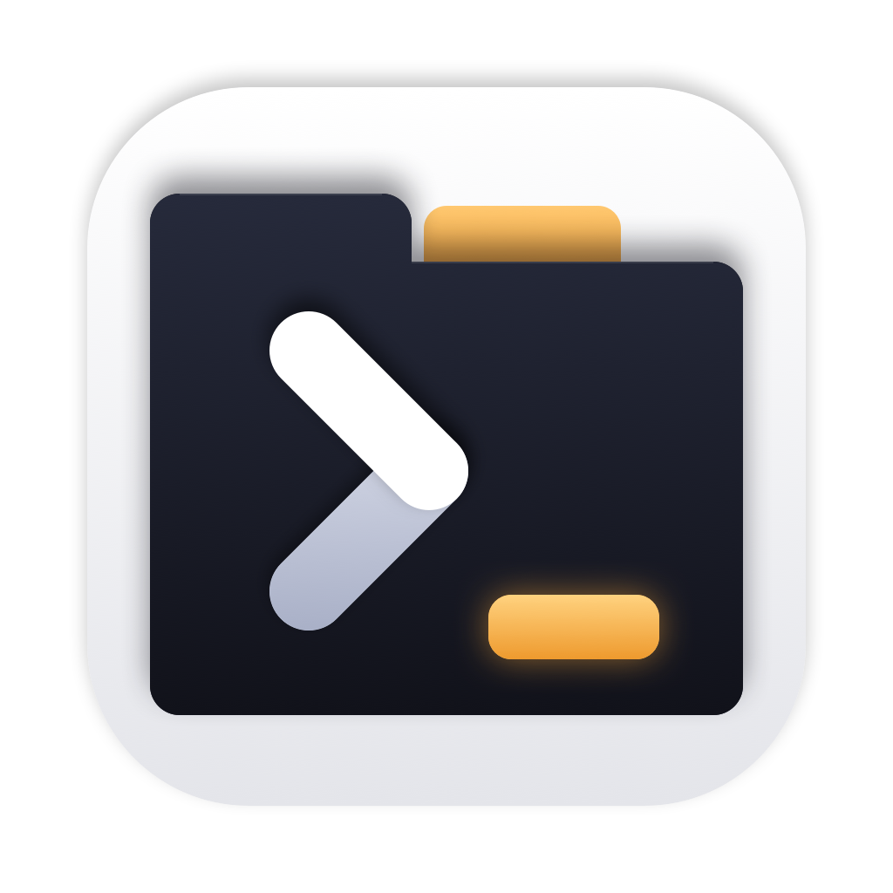
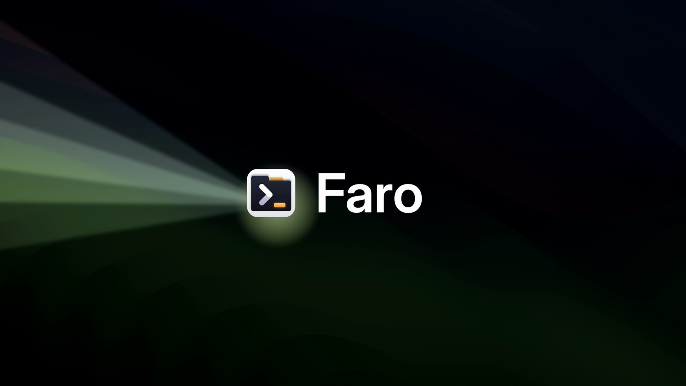

<p align="center">
  
</p>

<h1 align="center">Faro</h1>

<p align="center">
  A native macOS terminal built for working with Claude Code and other AI tools.<br>
  As light as Terminal.app, with the things you'd miss from Warp.
</p>

<p align="center">
  <a href="docs/faro-demo-github.mp4"></a>
</p>

> The app itself is in Spanish for now.

## Install

```bash
curl -fsSL https://raw.githubusercontent.com/lucasm6195/faro/main/install.sh | bash
```

or with Homebrew:

```bash
brew tap lucasm6195/tap && brew trust lucasm6195/tap
brew install --cask lucasm6195/tap/faro
```

or grab the `.dmg` from the [latest release](https://github.com/lucasm6195/faro/releases/latest). Faro is signed but not notarized, so if you install it by hand macOS will complain the first time: open **System Settings → Privacy & Security → Open Anyway**, or run `xattr -dr com.apple.quarantine /Applications/Faro.app`.

Requires macOS 15 (Sequoia) or later. Apple Silicon and Intel.

## Memory use

| | Faro | Warp |
|---|---|---|
| 1 idle tab | **50 MB** | 235 MB |
| 10 idle tabs | 57 MB | — |
| Idle CPU (10 s, 10 tabs) | 0 ms | — |

## What it does

- **Notch island**: while Claude Code (or Codex, Gemini, OpenCode, Ollama…) works in a tab you're not looking at, the notch shows how long it's been going or how many of its tasks are done, "waiting for you" when it asks something, and "done" when it finishes. Click it to jump back.
- **Ask Claude about an error**: every failed command gets a button that opens Claude in a split with the command and its output.
- **Session restore**, including each tab's exact Claude conversation (`claude --resume`).
- **Offline suggestions** as you type, learned from your history and your project; next-command prediction.
- **Command blocks** like Warp: copy the output, copy the command, ask Claude or rerun it.
- **Git in the status bar**, with pull, push, commit and diff.
- **Open ports** (⌃⌘P): what's still listening, which project it belongs to and who left it running — kill it in one click.
- **Port already in use?** Faro tells you who has it and offers "close it and retry".
- **One-click projects**: save a layout (Claude on the left, dev server and a shell on the right) and open it from ⌘P or ⌃⌘1…9.
- **⌘-click paths** like `src/app/page.tsx:42` to open them in your editor at that line (VS Code, Cursor, Zed, Windsurf, Sublime, Xcode…).
- **Drop-down terminal** from anywhere with ⌃⌥Space.
- Clickable path, command palette, split panes, sidebar tabs, 12 themes, notifications for long commands.

Everything stays on your Mac: no analytics, no network calls.

## Build from source

```bash
git clone https://github.com/lucasm6195/faro.git && cd faro
./build.sh && cp -R Faro.app /Applications/
```

Needs Swift 6 (Xcode 16 or the Command Line Tools). `swift test` runs the core tests.

## License

[MIT](LICENSE). Terminal engine: [SwiftTerm](https://github.com/migueldeicaza/SwiftTerm). Fonts: Inter, Geist Mono and JetBrains Mono (SIL OFL).
