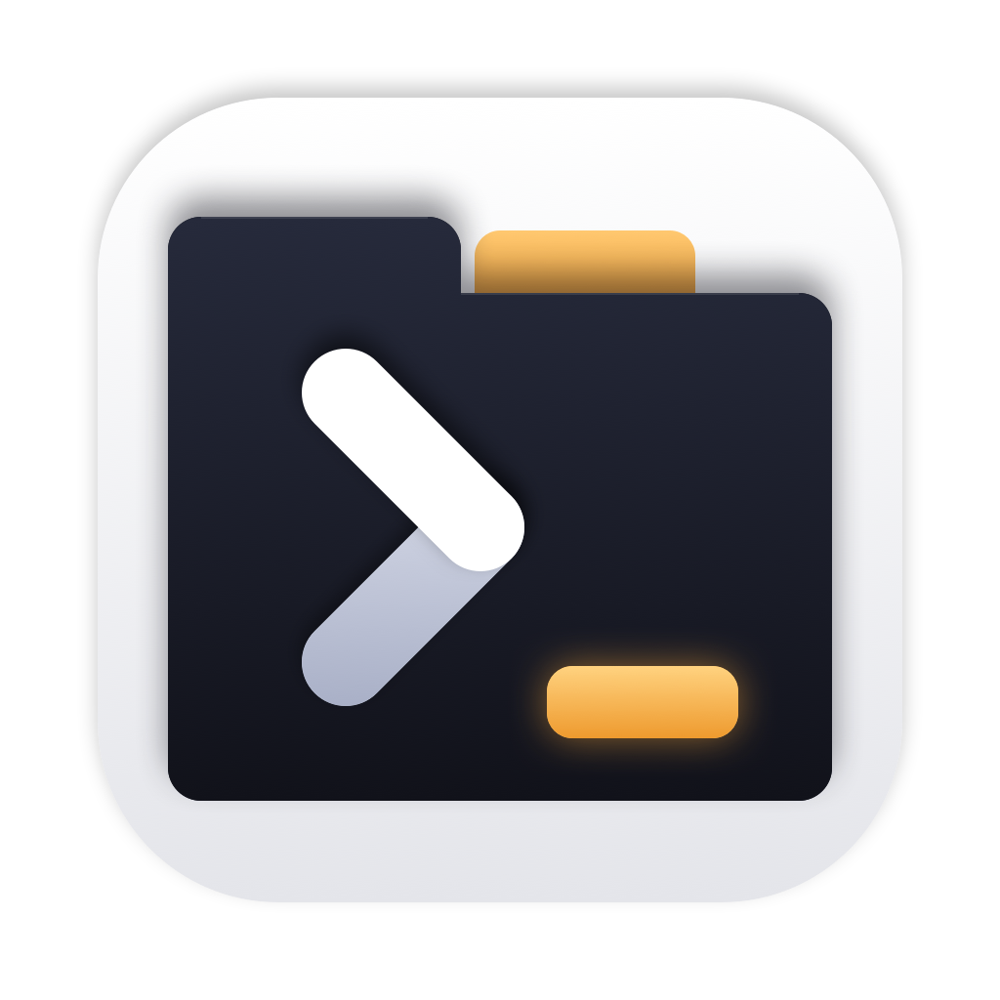

<p align="center">
  
</p>

<h1 align="center">Faro</h1>

<p align="center">
  Una terminal nativa para macOS que gasta lo que Terminal.app<br>
  y trae lo que echabas de menos de Warp. Y si trabajas con IAs, te lo pone fácil.
</p>

<p align="center">
  <a href="https://github.com/lucasm6195/faro/releases/latest"></a>
  
  
  <a href="LICENSE"></a>
</p>

https://github.com/user-attachments/assets/1560db1b-9b3d-448e-bb6e-aafaba2c68fa

<p align="center"><sub>También en 1440p a 60 fps en la <a href="https://github.com/lucasm6195/faro/releases/latest">última versión</a>.</sub></p>

<p align="center"><a href="README.en.md">English version</a></p>

---

## Instalar

**Con una línea** (descarga la última versión, la deja en Aplicaciones y la abre):

```bash
curl -fsSL https://raw.githubusercontent.com/lucasm6195/faro/main/install.sh | bash
```

**Con Homebrew:**

```bash
brew tap lucasm6195/tap && brew trust lucasm6195/tap
brew install --cask lucasm6195/tap/faro
```

**A mano:** baja el `.dmg` de la [última versión](https://github.com/lucasm6195/faro/releases/latest) y arrastra Faro a Aplicaciones.

> Faro está firmado pero no notarizado por Apple (para eso hace falta la cuenta de pago de desarrollador). Si lo instalas a mano, la primera vez macOS dirá que no puede comprobarlo: ve a **Ajustes del Sistema → Privacidad y seguridad** y pulsa **Abrir igualmente**, o ejecuta `xattr -dr com.apple.quarantine /Applications/Faro.app`. Con el comando de arriba o con Homebrew no hace falta.

Necesita macOS 15 (Sequoia) o posterior. Funciona en Apple Silicon y en Intel.

## Por qué otra terminal

Probé cinco terminales. Todas cumplen, pero o gastan mucho o se quedan cortas, así que me hice la mía: tan ligera como Terminal.app, con lo que hace cómoda a Warp y con detalles para cuando tienes Claude Code u otra IA trabajando. Esto es lo que gasta:

| | Faro | Warp |
|---|---|---|
| 1 pestaña sin hacer nada | **50 MB** | 235 MB |
| 10 pestañas sin hacer nada | 57 MB | — |
| CPU en reposo (10 s, 10 pestañas) | 0 ms | — |
| Después de imprimir un millón de líneas | 73 MB | — |

Medido con `footprint` (la misma cifra que el Monitor de Actividad) en un Mac con Apple Silicon. Las pestañas que no ves no se dibujan, no hay ningún temporizador corriendo en reposo y, tras una ráfaga de salida, la memoria temporal vuelve al sistema.

## Lo que hace

### Para trabajar con IAs

- **La isla del notch.** Mientras Claude Code (o Codex, Gemini, OpenCode, Ollama…) trabaja en una pestaña que no estás mirando, el notch enseña su logo y cuánto lleva, o cuántas tareas de su lista ha hecho (3/4). Si te pregunta algo pone «Te espera», y cuando acaba, «Listo». Al pasar el ratón se abre con el detalle y con un clic vuelves a esa pestaña. Solo existe mientras hay una IA en marcha. ⌃⌘I la activa o desactiva.
- **Pregúntale a Claude por un error.** Cada comando que falla tiene un botón que abre Claude al lado con el comando y su salida, sin copiar ni pegar nada. También con ⇧⌘E.
- **Retoma las conversaciones.** Si cierras Faro y lo vuelves a abrir, cada pestaña que tenía Claude retoma su conversación exacta (`claude --resume`), con sus paneles y carpetas.
- **Detecta las IAs que tienes instaladas** (Claude Code, Codex, Gemini CLI, OpenCode, Cursor Agent, Copilot CLI, Qwen Code, Grok, Ollama) y te las ofrece junto al «+», con su logo en la pestaña mientras trabajan.

### Para el día a día

- **Sugerencias mientras escribes**, sin conexión: aprende de tu historial (qué usas, dónde y si salió bien) y de tu proyecto (`package.json`, `Package.swift`, Cargo, Makefile, Docker, git…). → acepta el texto fantasma; ↑↓ y Tab para la lista.
- **Te propone el siguiente comando**: con la línea vacía, la barra de abajo sugiere lo que sueles hacer después.
- **Cada comando es un bloque**, como en Warp: al pasar el ratón se marca con su resultado y su duración, y puedes copiar la salida, copiar el comando, preguntarle a Claude o repetirlo.
- **Git en la barra de abajo**: rama, archivos cambiados, commits por subir y por bajar. Al pulsarlo, la lista de cambios y botones de Pull, Push, Commit y Diff.
- **Puertos abiertos** (⌃⌘P): qué sigue escuchando (`localhost:3000`…), de qué proyecto es, cuánto lleva abierto y quién lo dejó ahí, sea una pestaña tuya o una IA. Se cierra con un clic, con todos sus procesos hijos.
- **¿Puerto ocupado?** Si un `npm run dev` no arranca porque el puerto está cogido, Faro te dice quién lo tiene y te ofrece «Cerrarlo y reintentar».
- **Proyectos con un clic**: guarda cómo te gusta tener cada proyecto (por ejemplo Claude a la izquierda, `npm run dev` arriba a la derecha y una shell abajo) y ábrelo entero desde ⌘P o con ⌃⌘1…9.
- **⌘ + clic en rutas y enlaces** de la salida: `src/app/page.tsx:42` se abre en tu editor en esa línea. VS Code por defecto; también Cursor, Zed, Windsurf, Antigravity, Sublime o Xcode.
- **Terminal desplegable** (⌃⌥Espacio desde cualquier app): baja desde arriba, encima de lo que estés haciendo, y se esconde con el mismo atajo.
- **La ruta es un botón**: cada carpeta de la barra de abajo te lleva a ella sin escribir `cd`.
- **Paleta de comandos** (⌘P): acciones, saltar a cualquier carpeta por su nombre, scripts del proyecto, historial y temas.
- **Paneles divididos** (⌘D, ⇧⌘D), pestañas arriba o en una barra lateral (⌃⌘S), explorador de carpetas (⌘O) y saltos entre comandos (⌘↑ ⌘↓).
- **12 temas** (Faro Noche, Faro Día, Tokyo Night, Catppuccin, Dracula, Nord, Gruvbox, One Dark, Rosé Pine, GitHub Dark, Solarized…) que cambian solos con el modo claro u oscuro.
- **Avisos** cuando acaba un comando largo que no estabas mirando.
- **Hecha para el teclado español**: Opción escribe `@ # | [ ] { }` como en cualquier app.

### Editar la línea como un documento

| Atajo | Qué hace |
|---|---|
| ⌘⌫ / ⌘⌦ | Borrar hasta el principio / el final de la línea |
| ⌥⌫ / ⌥⌦ | Borrar la palabra anterior / siguiente |
| ⌘← / ⌘→ | Ir al principio / al final (⌘→ también acepta la sugerencia) |
| ⌥← / ⌥→ | Palabra anterior / siguiente |
| ⇧ + flechas | Seleccionar; lo que escribas lo sustituye |
| ⌘A · ⌘C · ⌘X | Seleccionar la línea, copiar, cortar |
| ⌘Z / ⇧⌘Z | Deshacer / rehacer |

Dentro de Claude Code o ssh se traducen a sus equivalentes; en vim y programas a pantalla completa no se tocan.

## Atajos

| Atajo | Qué hace |
|---|---|
| ⌘T / ⌘N | Pestaña / ventana nueva |
| ⇧⌘C | Abrir Claude Code |
| ⌘P | Paleta de comandos |
| ⌘O | Explorar carpetas |
| ⇧⌘E | Explicar el último error con Claude |
| ⌘D / ⇧⌘D | Dividir a la derecha / hacia abajo |
| ⌥⌘ + flechas | Ir al panel de al lado |
| ⇧⌘↩ | Ampliar o restaurar el panel |
| ⌘1…9 · ⇧⌘[ ⇧⌘] | Cambiar de pestaña |
| ⌘↑ / ⌘↓ | Comando anterior / siguiente |
| ⌃⌘S | Pestañas arriba o en la barra lateral |
| ⌃⌘I | Isla del notch |
| ⌃⌘P | Puertos abiertos |
| ⌃⌘1…9 | Abrir un proyecto |
| ⌃⌥Espacio | Terminal desplegable |
| ⌥⌘C | Copiar la salida del último comando |
| ⌘K | Limpiar la pantalla |
| ⌘F | Buscar |
| ⌘+ / ⌘- / ⌘0 | Tamaño de letra |
| ⌘, | Ajustes |

## Como terminal principal

- Abre con doble clic los scripts `.command` y los ejecutables, los enlaces `ssh://` y `telnet://` y las páginas de `man`.
- Arrastra una carpeta al icono de Faro para abrir una pestaña allí.
- En el Finder, clic derecho en una carpeta → Servicios → «Nueva pestaña de Faro aquí» o «Abrir Claude Code aquí con Faro».

## Privacidad

Todo se queda en tu Mac: ajustes, historial y proyectos están en `~/Library/Application Support/Faro`. Faro no manda nada a ningún sitio ni tiene analíticas. Tu configuración de zsh no se toca: Faro carga la suya propia y después la tuya de siempre.

## Compilar desde el código

Necesitas Xcode 16 o las Command Line Tools con Swift 6.

```bash
git clone https://github.com/lucasm6195/faro.git && cd faro
./build.sh
cp -R Faro.app /Applications/
```

- `swift test` pasa los tests del núcleo (sugerencias, integración con zsh, historial, git, puertos…).
- `./scripts/dev-run.sh` abre «Faro Dev», una copia aparte para probar sin tocar tu Faro.
- `./scripts/release.sh 1.0.1` prepara una versión para publicar (app universal, `.dmg` y `.zip`).
- `./scripts/demo/record.sh` vuelve a grabar el vídeo: un guion maneja Faro Dev con datos de ejemplo y lo graba con ScreenCaptureKit (hay que darle permiso de grabación de pantalla). En la escena del notch abre Claude Code de verdad, así que tarda unos minutos.

<details>
<summary>Cómo está hecho</summary>

```
Sources/FaroCore/   Lógica sin interfaz, con tests
  ShellIntegration  Script de zsh y protocolo de eventos (OSC 6973 + OSC 133)
  SuggestionEngine  Sugerencias y predicción del siguiente comando
  CommandHistory    Historial y carpetas frecuentes
  ProjectContext    Detección del proyecto y de la rama de git sin lanzar procesos
  AgentActivity     Qué está haciendo cada IA, leyendo su pantalla
  ListeningPorts    Puertos abiertos y a qué proceso, proyecto e IA pertenecen (libproc)
  Workspace         Pestañas, paneles y conversaciones de Claude para retomar
  GitStatus         git status --porcelain=v2
  CommandBlocks     Dónde empieza y acaba cada comando
  Projects, Links, PortConflict, Theme, Settings
Sources/Faro/       La app (AppKit + SwiftUI + SwiftTerm)
Bench/FaroBench     Banco de pruebas de consumo
```

Faro arranca zsh con `ZDOTDIR` apuntando a su propia carpeta, cuyo `.zshenv` devuelve `ZDOTDIR` a su valor y carga tu configuración. Así sabe la carpeta, cada comando, su duración y su resultado, y puede cambiar de carpeta o rellenar la línea sin escribir nada visible ni ensuciar tu historial.

El terminal es [SwiftTerm](https://github.com/migueldeicaza/SwiftTerm), dibujado por CPU por defecto: con Metal cada pestaña costaba unos 30 MB más a cambio de un 17 % menos de CPU en salidas enormes (se puede activar en Ajustes → Rendimiento). Los puertos se leen del núcleo con libproc, sin lanzar `lsof`.

</details>

## Créditos

- Terminal: [SwiftTerm](https://github.com/migueldeicaza/SwiftTerm), de Miguel de Icaza.
- Tipografías: [Inter](https://rsms.me/inter/), [Geist Mono](https://vercel.com/font) y [JetBrains Mono](https://www.jetbrains.com/lp/mono/), con licencia SIL Open Font License (en `Resources/Fonts`).
- Logos de las herramientas de IA: [svgl.app](https://svgl.app). Son marcas de sus dueños y solo se usan para reconocer cada herramienta.

## Licencia

[MIT](LICENSE).
